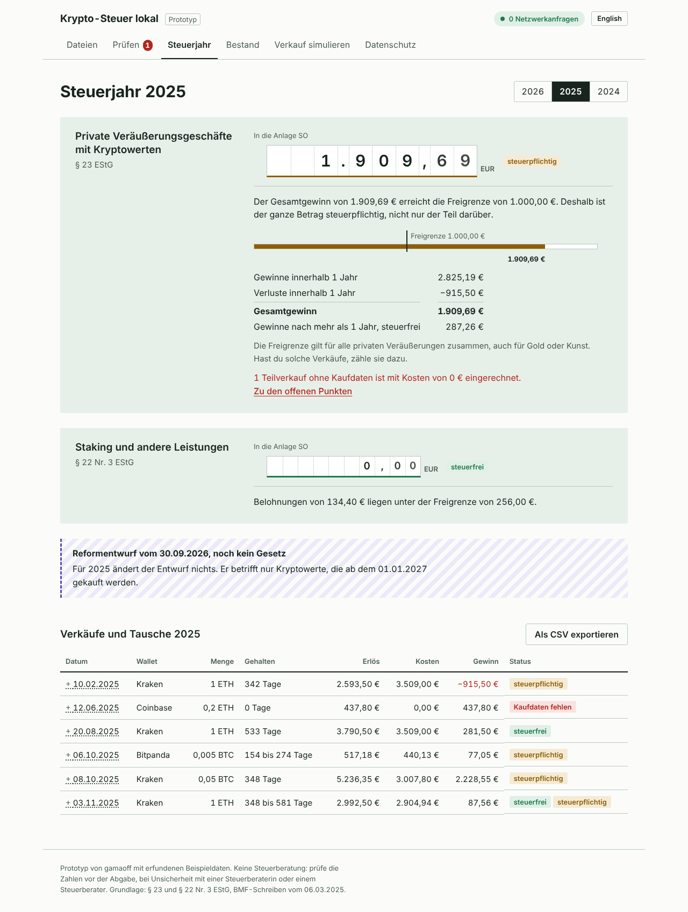
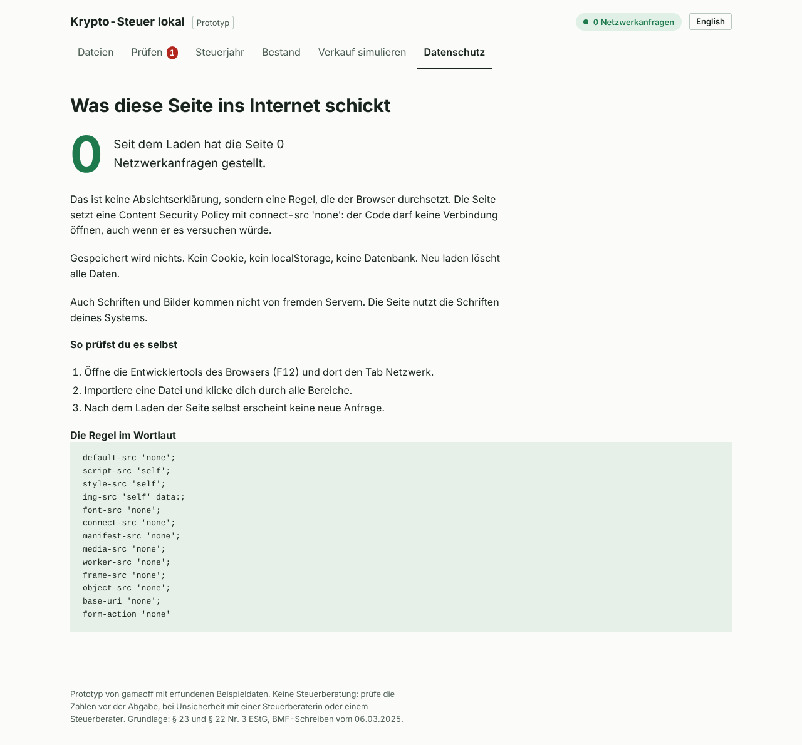

# Krypto-Steuer lokal

A crypto tax prototype for private investors in Germany that runs entirely in the browser. It turns exchange exports into the numbers for the Anlage SO, shows when each holding becomes tax-free, and sends nothing to any server.



## Why this exists

I assumed the problem with crypto tax tools was the interface. Talking it through, the sharper problem turned out to be what they know about you.

Since 2026, German exchanges report to the Bundeszentralamt für Steuern under the KStTG. That report holds annual totals per coin, without dates or single trades. A cloud tax tool, by contrast, receives every transaction, every wallet address and your identity. It ends up knowing more about your finances than the tax office does.

The BMF letter of 6 March 2025 also puts the burden of proof on the taxpayer: date, type, amount, euro value and wallet for every transaction. So the job is to keep a complete, checkable record that stays with you. This prototype tests whether that can be done without giving the record to anyone.

## What it does

- Imports CSV files, drag and drop, several at once. A synthetic sample history is built in.
- Tracks lots first in, first out, separately per wallet, as the BMF requires.
- Moves units between own wallets without treating it as a sale. Acquisition date and cost travel with them.
- Applies § 23 EStG: tax-free after more than 1 year, with the 1,000 EUR Freigrenze applied to the net gain of the year.
- Applies § 22 Nr. 3 EStG to staking rewards, with the 256 EUR Freigrenze.
- Flags sales without purchase data and calculates them the way the tax office may estimate: cost 0, no holding period.
- Shows every holding with the day it becomes tax-free.
- Simulates a sale before you make it: which lots go first, what is tax-free, and how long to wait until all of it is.
- Runs the reform draft of 30 September 2026 as a separate scenario. Under the draft, crypto bought after 31 December 2026 would become capital income at 25 % plus Soli. It is not law, so it never changes the main result.
- Links every number back to the file and line it came from, and exports the year's disposals as CSV.
- German and English interface.

## How the privacy claim is enforced

A promise in a README is not a guarantee, so the page enforces it in the browser:

- The Content Security Policy in [`index.html`](index.html) sets `connect-src 'none'`. The code cannot open a connection, even if it tried. A test `fetch` to the internet is blocked and shows up on the privacy page.
- Loading the page makes 3 requests: the HTML, 1 CSS file and 1 JS file, all from the same origin. No fonts, no CDN, no analytics, no favicon request.
- Nothing is stored. No cookie, no localStorage, no IndexedDB. Reloading clears everything.
- The sample data is bundled into the JS, so even the demo needs no extra request.

To check it yourself: open the developer tools, go to the Network tab, import a file and click through every section.



## Run it

Requires Node.js 22 or later.

```bash
npm install
npm run dev        # http://localhost:5173, reload by hand after changes
npm test           # 38 tests, node:test
npm run typecheck
npm run build      # static files in dist/
```

The dev server has no live reload on purpose: live reload needs a network connection, which the policy forbids.

## Project structure

```
src/engine/   Tax logic, no UI and no dependencies
  decimal.ts    Exact BigInt decimal arithmetic, 18 digits
  dates.ts      Berlin calendar days, one-year rule per §§ 187, 188 BGB
  csv.ts        RFC 4180 reader, also semicolons and German number formats
  parse.ts      CSV rows to transactions, with readable error codes
  engine.ts     Lots, FIFO per wallet, transfers, disposals, rewards
  tax.ts        Yearly summary, exemption limits, draft scenario, sale simulator
  rules.ts      Tax rules as versioned data, with sources
src/ui/       React interface
test/         Cases calculated by hand
sample/       Synthetic history and the script that generates it
docs/         CSV format
```

## Decisions

- **Browser only, no backend.** The privacy argument holds only if there is nothing to send data to. A static page also deploys anywhere and can later be wrapped as a desktop app with Tauri.
- **2 runtime dependencies.** React and React DOM. Decimal math and CSV parsing are written in the project, about 220 lines together, because every dependency is part of what a privacy tool asks people to trust.
- **No floats for money.** All amounts are BigInt with 18 decimal places, enough for 1 wei. Proceeds split across lots always add up to the exact total.
- **Rules are data.** Thresholds and dates live in `rules.ts` with their sources, so a law change means a new rule version, not edited logic.
- **Conservative when data is missing.** A sale without a known purchase is treated the way the tax office may estimate. The app would rather overstate tax than understate it.

## Limits

- Only the generic CSV format described in [docs/CSV-FORMAT.md](docs/CSV-FORMAT.md). Exchange-specific exports are next.
- No DeFi, NFTs, margin or futures.
- Transfer fees paid in crypto are not supported.
- Prices are never looked up. Values come from the imported files, and the simulator asks you for the price.
- The 1,000 EUR Freigrenze covers all private disposals of the year, including gold or art. The app only sees crypto.

This is a prototype, not tax advice. Check the numbers before filing, and ask a tax adviser when in doubt.

## Status

Prototype, October 2026. Next steps: usability tests with 5 people who file their own taxes, parsers for Bitpanda, Kraken and Coinbase exports, and a desktop build.

## License

Copyright 2026 gamaoff. Licensed under the GNU Affero General Public License v3.0 or later, see [LICENSE](LICENSE).

The author holds the copyright and may also offer the software under other terms, for example a commercial license. Outside contributions will need a contributor agreement that allows this, so please open an issue before sending a pull request.
